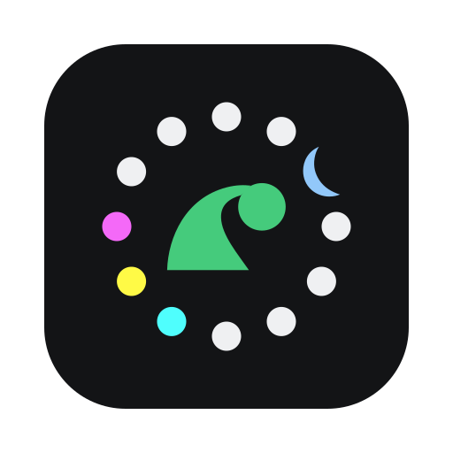

# LazyGit for CadencR

<p align="center"></p>

A standalone custom tab that runs the installed
**[LazyGit](https://github.com/jesseduffield/lazygit) binary directly**
in the conversation's worktree. No Neovim runtime is involved.

- CadencR **0.16.2+**, LazyGit and Git are required.
- macOS Apple silicon, macOS Intel and Linux x86-64 are supported.
- The terminal uses CadencR colors and font preferences.
- Theme synchronization is enabled by default. The plugin writes a small
  override in its own state directory, isolated per conversation, and layers it after your existing
  LazyGit configuration. It does not rewrite your configuration.
- Hiding the tab or reloading its webview reattaches to the same LazyGit
  process while CadencR keeps the native backend alive. Stopping that backend
  ends the terminal session.
- Quota errors pause requests and preserve queued keyboard input. Other
  failures are shown without replaying input.
- Commits, staging, rebases and pushes use your normal Git configuration
  and happen through your own actions inside LazyGit.

## Build and verify

Requires Node.js 22.19+ and Go 1.23+.

```sh
npm ci
npm test
npm run test:backend
npm run build
npm run test:ui
```

Install Chromium for the browser tests with `npx playwright install chromium`,
or use an existing Chrome installation with `PLAYWRIGHT_CHANNEL=chrome`.
To include a test of your installed LazyGit in a disposable repository:

```sh
CADENCR_LAZYGIT_SMOKE="$(command -v lazygit)" npm run test:ui
```

Build all declared native backends and stage a local installation:

```sh
npm run build:backend -- --all
npm run stage
```

To keep an earlier staged build, pass a new destination:

```sh
npm run stage -- staging/next/lazygit
```

The final directory must be named `lazygit`, matching the manifest's tab ID.
Validate the staged folder, rather than the differently named source repository:

```sh
cadencr plugin validate staging/next/lazygit --kind tab
```

Use a CLI built from CadencR 0.16.2 or later that understands `tab.replaces`.
The CLI has its own version number, independent of the app version.

The macOS arm64 executable is ad-hoc signed when built on macOS.
Cross-compilation does not establish native test coverage for another platform.

## Install locally

Copy the prepared `staging/lazygit` directory into your custom tab directory:

- macOS: `~/.cadencr/plugins/tabs/lazygit`
- Linux: `$XDG_DATA_HOME/cadencr/plugins/tabs/lazygit`
  (default `~/.local/share/cadencr/plugins/tabs/lazygit`).

Enable the tab and approve its native backend in **Settings → Custom tabs**.
Then choose LazyGit for **Git** under **Replace built-in tabs**.
Installation alone does not enable it or select the replacement.

CadencR may temporarily restore its built-in Git tab when a native action
opens a pull request. The tab strip's **+** menu switches back to LazyGit.

## Settings

| Setting | Default | Purpose |
| --- | --- | --- |
| `lazygit_path` | `lazygit` | Executable name or absolute path |
| `sync_theme` | `true` | Layer CadencR colors over your LazyGit configuration |

These are startup options. After changing them, quit LazyGit and start it
again so the new process reads them.

Theme changes update the same override file; xterm picks them up immediately.
LazyGit's own configuration reloading determines when the running interface
applies the file. When a change would alter the colors LazyGit uses, a
"Reload LazyGit (theme changed)" button offers a restart; choosing it
replaces the running process, and the new process reads the latest palette.
With synchronization enabled, the adapter removes an inherited `NO_COLOR`
flag for the terminal process. Disable synchronization to retain that flag
and use LazyGit's own color preferences.

## Distribution

GitHub Actions builds and tests all three platforms natively. The workflow
also extracts and validates each backend archive and runs the browser tests
against those exact bytes, including the installed LazyGit in a disposable
repository. The compatible CadencR CLI 0.15.8 is built from the pinned
CadencR 0.16.2 source commit; it is not substituted for the registry's own
qualified CLI pin.

Tags matching `v*` generate public build attestations for the four archives
and `build-receipt.json`. The aggregate workflow artifact includes archive
checksums, native qualification reports and the exact source commit.
Release publication remains explicit: use a signed version tag, enable
GitHub release immutability, attach all assets to a draft, verify the build
attestations with `gh attestation verify`, then publish the draft.
A registry package using `tab.replaces` must require CadencR 0.16.2 or later.

The terminal adapter is derived from the MIT-licensed
[review.nvim](https://github.com/edjubert/review.nvim) CadencR integration.
Third-party notices for the bundled frontend, Go modules, Go runtime and
vendored standard-library dependencies are included in `dist/LICENSES`,
with an index in `dist/THIRD_PARTY_NOTICES.md`. LazyGit itself is installed
separately and is not bundled in the plugin.
