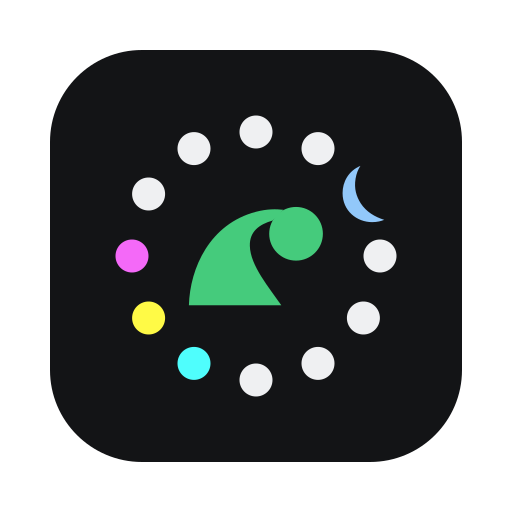

# LazyGit for CadencR

<p align="center"></p>

A standalone custom tab that runs the installed
**[LazyGit](https://github.com/jesseduffield/lazygit) binary directly**
in the conversation's worktree. No Neovim runtime is involved.

- CadencR **0.16.2+**, LazyGit and Git are required.
- macOS Apple silicon, macOS Intel and Linux x86-64 are supported.
- The terminal uses CadencR colors and font preferences.
- Theme synchronization is enabled by default. The plugin writes a small
  override in its own state directory, isolated per conversation, and layers it after your existing
  LazyGit configuration. It does not rewrite your configuration.
- Hiding the tab or reloading its webview reattaches to the same LazyGit
  process while CadencR keeps the native backend alive. Stopping that backend
  ends the terminal session.
- Quota errors pause requests and preserve queued keyboard input. Other
  failures are shown without replaying input.
- Commits, staging, rebases and pushes use your normal Git configuration
  and happen through your own actions inside LazyGit.

## Network access and credentials

The native backend launches your separately installed LazyGit with your user
permissions and inherited environment. The selected LazyGit executable, Git,
credential helpers, hooks and user-configured commands retain their normal
behavior. The tab's empty web permission list does not sandbox that native
process or restrict its network destinations to the CadencR server.

### Automatic fetches

Opening the tab can contact the worktree's configured Git remotes without a
manual fetch. In LazyGit 0.64.1 and 0.66.2, `git.autoFetch` defaults to `true`:
a fetch runs at startup, after the introductory prompts, and repeats according
to `refresher.fetchInterval` (60 seconds by default). Switching repositories
can also trigger a fetch. Fetches send repository identifiers and ref/object
negotiation data and use available Git/SSH authentication, including credential
helpers and SSH agents, for each remote.

Manual fetch, pull and push actions use your configured Git endpoints and
credentials. Pushes transmit selected repository objects. Hooks and custom
commands can make additional requests according to your own configuration.

### GitHub pull request and status refresh

In LazyGit 0.64.1 and 0.66.2, the full refresh scope includes pull requests.
When a GitHub or GitHub Enterprise remote has authentication available, LazyGit
runs `gh auth token --hostname <host>` (or falls back to go-gh's environment
and config lookup when `gh` is unavailable) and sends authenticated GraphQL
POST requests to `https://api.github.com/graphql` (or the Enterprise host's
`/api/graphql`). These requests carry the repository owner and name plus
upstream branch names, and ask for pull request and check-run status. LazyGit
can make these requests during startup, after Git fetches, when the terminal
reports that LazyGit has regained focus, and when background detection finds a
Git reference change. `refresher.fetchInterval` controls the automatic Git
fetch schedule. It does not control the other triggers.
`git.autoDetectExternalChanges: false` disables the ref-change trigger only.
There is no dedicated GraphQL opt-out in these versions. To prevent these
requests through authentication scoping, run LazyGit without an available
GitHub token for any eligible remote, including tokens supplied through the
inherited environment and those available through the CLI or its configuration.

### LazyGit updates

Official standalone LazyGit builds can also check
`https://github.com/jesseduffield/lazygit/releases/latest` for updates.
Availability and timing depend on the installed build and `update.days`
(14 days by default). Homebrew and unversioned builds skip the automatic
check in the versions inspected; other package-manager builds may skip it too.

The check can also request the headers of a platform-specific release archive
on GitHub before offering an update. These requests disclose normal connection
metadata, such as your IP address, and the archive URL identifies your operating
system and architecture. These public requests do not use Git/SSH credential
helpers. Accepting an update, or enabling
`update.method: background`, can download the archive from GitHub and its
release-asset hosts and replace the installed LazyGit executable. LazyGit
controls this behavior.

### Disable automatic network activity

Merge these options into your existing LazyGit configuration to disable
automatic fetches and automatic update checks:

```yaml
git:
  autoFetch: false
update:
  method: never
```

These options do not disable network access from manual Git actions, manually
requested update checks, hooks or custom commands. They also do not disable the
GitHub pull request and status requests described above, which follow their own
triggers and authentication scoping. Restart LazyGit after changing these
startup options.

These defaults were checked against LazyGit 0.64.1 and 0.66.2. The tab does not
pin or install LazyGit or Git; other versions may behave differently. Review
the selected executable and its configuration before activation.

## Build and verify

Requires Node.js 22.19+ and Go 1.23+.

```sh
npm ci
npm test
npm run test:backend
npm run build
npm run test:ui
```

Install Chromium for the browser tests with `npx playwright install chromium`,
or use an existing Chrome installation with `PLAYWRIGHT_CHANNEL=chrome`.
To include a test of your installed LazyGit in a disposable repository:

```sh
CADENCR_LAZYGIT_SMOKE="$(command -v lazygit)" npm run test:ui
```

Build all declared native backends and stage a local installation:

```sh
npm run build:backend -- --all
npm run stage
```

To keep an earlier staged build, pass a new destination:

```sh
npm run stage -- staging/next/lazygit
```

The final directory must be named `lazygit`, matching the manifest's tab ID.
Validate the staged folder, rather than the differently named source repository:

```sh
cadencr plugin validate staging/next/lazygit --kind tab
```

Use a CLI built from CadencR 0.16.2 or later that understands `tab.replaces`.
The CLI has its own version number, independent of the app version.

The macOS arm64 executable is ad-hoc signed when built on macOS.
Cross-compilation does not establish native test coverage for another platform.

## Install locally

Copy the prepared `staging/lazygit` directory into your custom tab directory:

- macOS: `~/.cadencr/plugins/tabs/lazygit`
- Linux: `$XDG_DATA_HOME/cadencr/plugins/tabs/lazygit`
  (default `~/.local/share/cadencr/plugins/tabs/lazygit`).

Enable the tab and approve its native backend in **Settings → Custom tabs**.
Then choose LazyGit for **Git** under **Replace built-in tabs**.
Installation alone does not enable it or select the replacement.

CadencR may temporarily restore its built-in Git tab when a native action
opens a pull request. The tab strip's **+** menu switches back to LazyGit.

## Settings

| Setting | Default | Purpose |
| --- | --- | --- |
| `lazygit_path` | `lazygit` | Executable name or absolute path |
| `sync_theme` | `true` | Layer CadencR colors over your LazyGit configuration |

These are startup options. After changing them, quit LazyGit and start it
again so the new process reads them.

Theme changes update the same override file; xterm picks them up immediately.
LazyGit's own configuration reloading determines when the running interface
applies the file. When a change would alter the colors LazyGit uses, a
"Reload LazyGit (theme changed)" button offers a restart; choosing it
replaces the running process, and the new process reads the latest palette.
With synchronization enabled, the adapter removes an inherited `NO_COLOR`
flag for the terminal process. Disable synchronization to retain that flag
and use LazyGit's own color preferences.

## Distribution

GitHub Actions builds and tests all three platforms natively. The workflow
also extracts and validates each backend archive and runs the browser tests
against those exact bytes, including the installed LazyGit in a disposable
repository. The compatible CadencR CLI 0.15.8 is built from the pinned
CadencR 0.16.2 source commit; it is not substituted for the registry's own
qualified CLI pin.

Tags matching `v*` generate public build attestations for the four archives
and `build-receipt.json`. The aggregate workflow artifact includes archive
checksums, native qualification reports and the exact source commit.
Release publication remains explicit: use a signed version tag, enable
GitHub release immutability, attach all assets to a draft, verify the build
attestations with `gh attestation verify`, then publish the draft.
A registry package using `tab.replaces` must require CadencR 0.16.2 or later.

The terminal adapter is derived from the MIT-licensed
[review.nvim](https://github.com/edjubert/review.nvim) CadencR integration.
Third-party notices for the bundled frontend, Go modules, Go runtime and
vendored standard-library dependencies are included in `dist/LICENSES`,
with an index in `dist/THIRD_PARTY_NOTICES.md`. LazyGit itself is installed
separately and is not bundled in the plugin.
